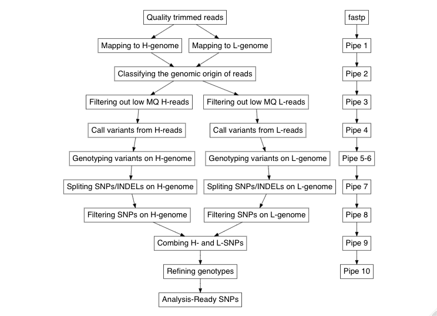

# Polymorphism analysis in the allopolyploid model plant <i>Arabidopsis kamchatica</i>
Bioinformatics pipeline for SNPs calling workflow for RAD-seq analysis of <i>Arabidopsis kamchatica</i>
 


## Requirement

* samtools: Tools for manipulating NGS data https://github.com/samtools/samtools
* vcftools: A set of tools for working with VCF files https://github.com/vcftools/vcftools
* BWA: Burrow-Wheeler Aligner http://bio-bwa.sourceforge.net
* GATK: Genome Analysis Toolkit https://gatk.broadinstitute.org/
* EAGLE: Explicit Alternative Genome Likelihood Evaluator https://github.com/tony-kuo/eagle
* Plink: Whole-genome association analysis tool https://www.cog-genomics.org/plink/

The environment under Ubuntu 24.04 was tested. The versions of the tools used were documented in a series of shell scripts.

## Reference genomes
<i>Arabidopsis kamchatica</i> is an allopolyploid species derived from the two diploid species <i>A. halleri</i> and <i>A. lyrata</i>. <i>Arabidopsis halleri</i> reference genome ([GCA_900078215.1](https://www.ncbi.nlm.nih.gov/datasets/genome/GCA_900078215.1/); hereafter H-genome) is from Briskine et al. (2016); <i>A. lyrata</i> reference genome ([GCA_900205625.1](https://www.ncbi.nlm.nih.gov/datasets/genome/GCA_900205625.1/); hereafter L-genome) is from Paape et al. (2018). 

Briskine, R. V. et al. (2016) Genome assembly and annotation of <i>Arabidopsis halleri</i>, a model for heavy metal hyperaccumulation and evolutionary ecology. Molecular Ecology. Resources 5: 1025–1036.  https://doi.org/10.1111/1755-0998.12604

Paape T. et al. (2018) Patterns of polymorphism and selection in the subgenomes of the allopolyploid <i>Arabidopsis kamchatica</i>. Nature communications. 9(1):3909. https://doi.org/10.1038/s41467-018-06108-1


## The sequencing data
All demultiplexed RAD-seq raw reads are available from the DNA Data Bank of Japan Sequence Read Archive (BioProject accession number: PRJDB10775).

## Flowchart
 
<p align="left">
  
</p>


## Usage
Run a series of the shell scripts in the order listed after changing paths according to your environemt:
 
```bash
Pipe.01.BWA_mapping.sh
Pipe.02.eagle_rc.sh
Pipe.03.BamFiltering.sh
...
Pipe.11.GenotypeFiltering.sh
```


## Within fsc/:
This directory contains the input files for demographic modeling using the fastsimcoal2 program.

## Software and versions
A list of software tools used for variant calling and downstreampopulation genomic analyses in this study, together with theirversions and source URLs, is available in [software_versions.csv](https://github.com/akihirao/Akam_RADseq/blob/main/software_versions.csv).

## Note
This project is currently under development. Thank you!

